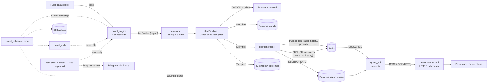

# Mobile backend readiness: audit of the engine, API and dashboard

Audit date: **2026-10-31** (Saturday, market closed). Code audited: `v2` at `2e33c59`; the live engine image is built from `696ad65` (same runtime code; later commits are docs only). Dashboard: `main` at `49a0f80`.
Read-only throughout: no change to `src/`, config, compose, the server or the database; no restart, no deploy, no Fyers call. Goal document: `mobile-ready-backend-goal.md` (owner's copy).

**Evidence labels.** **Verified**: checked against the running system, a command output or a test run in this audit. **Tested on paper**: read in code, reasoned through, not exercised. **Unverified**: could not be checked here; says why.
No secrets, addresses, hostnames, port numbers, chat ids or account details appear in this report: services are named instead ("the API port", "the Redis port").

---

## Executive summary (one page)

**Bottom line.** The engine is a stable single-user paper-trading system, but it is **not yet a backend a phone can safely talk to**. The API is read-only, unauthenticated, unversioned and open to any caller; live events have no ids, so a phone that sleeps or changes network cannot catch up; and the history the API returns by default mixes in rows that are known to be invented or approximate. None of this is hard to fix, but most of it touches the API on separate evenings, and the goal's own Phase 0 gate is **not met** today.

**Phase 0 gate (goal §"Prerequisite gate"): not met.**

| Gate item | State | Evidence |
|---|---|---|
| Cleanup goal (versioned migrations, alert policy, `signals`, ghost rows) | **Met** | `schema_migrations` has 0001–0004, 0006, 0007 (Verified, query); policy in `src/workers/alertPolicy.ts:15,24,114`; ghosts resolved by `0003` |
| Fresh `pg_dump` **and a tested restore into a scratch DB** | **Not met** | Dumps exist daily (S3 verified 30 Oct). The only restore test is 2026-10-18 (`docs/RUNBOOK.md:184`), before `signals`, `ev_shadow_outcomes` and four other schema changes |
| Deployed SHA and restart counts in `docs/RUNBOOK.md` | **Not met** | The record stops at `bb7fb46` on 2026-10-18 (`docs/RUNBOOK.md:9-27`); current records live in `HANDOFF.md` instead |
| `data_quality` provenance column | **Met** | Migration `0002_data_quality.sql:7` (Verified, 7 flags in use) |

**Five things that matter most.**
1. **Redis has no password, protected mode is off, and it is published on all interfaces** (Verified: `CONFIG GET requirepass` empty, `protected-mode no`, host listener on all addresses). Only the cloud firewall blocks it; from this audit's network the port is filtered (Verified), but that was tested from one network only. Anyone who reaches it can rewrite open positions and P&L.
2. **The API is open to the internet with no auth and `CORS *`** (`src/api/server.ts:14`; the API port answered from outside, Verified). It is read-only (seven GET routes, no writes), so the damage is disclosure and load, not tampering.
3. **No replay.** Events go out over Redis pub/sub with no id (`src/core/positionTracker.ts:164,346,362`); the SSE route sends no `id:` field (`src/api/server.ts:214-238`). A reconnecting phone silently misses trades.
4. **The default history is not honest enough for a phone.** Of 404 closed alerted trades the API returns by default, **82 are invented ₹0/0R closes** (`synthetic_close`) and only 87 carry no quality flag (Verified, query). Clean alerted closed trades since the signal log began (21 Oct): **24**.
5. **The two files a phone depends on most have no executed tests.** `src/api/server.ts` and `src/ingestion/websocket.ts` are never run by the suite (Verified, coverage report); 395/395 tests pass three times in a row (no flakiness seen).

**What could exist by mid-November.** A private **internal-testing** Android build used only by the owner, reading a new **read-only `/api/v1`** over HTTPS with per-device tokens, polling every 30 s plus a snapshot endpoint. **Not** by mid-November: a Play Store production listing (needs a 14-day closed test with 12 opted-in testers, then a review of up to about 7 days), push notifications, and gap-free resumable streaming.

**Recommended first moves** (one change per evening): finish Phase 0 (current-schema restore test, RUNBOOK record) → lock Redis down → add `/api/v1` read-only with tokens, input validation and honest defaults → snapshot → only then streams and push.

**Not legal advice.** Sending the engine's signals to anyone but the owner may be a regulated activity; the 12-tester Play requirement itself means giving the app to 12 people. Keep it personal-use until a lawyer has looked (§5).

---

## 1. Architecture as it really is

### 1.1 Containers and processes (Verified: `docker ps`, `docker-compose.yml`)

| Container | Code / image | Lifecycle | Owns | Published to the host |
|---|---|---|---|---|
| `quant_redis` | `redis:7-alpine` | always on; AOF `everysec` + RDB `save 60 1` (`docker-compose.yml:10-14`) | all hot state (keys in §1.3) | **yes, all interfaces** (`:7-8`) |
| `quant_postgres` | `postgres:15-alpine` | always on | `paper_trades`, `signals`, `ev_shadow_outcomes`, `schema_migrations` | no (container network only) |
| `quant_scheduler` | Alpine + cron + Docker socket (`:33-47`) | always on | the daily lifecycle (cron below), 16:00 backup, screener trigger | no; **mounts the Docker socket** (`:42`) |
| `quant_auth` | Node, `src/config/auth.ts` | started 07:45 on trading days, exits after writing the token | the daily Fyers login (Telegram link → redirect → token file) | yes, the auth port (`:59-60`); filtered from this audit's network (Verified) |
| `quant_engine` | Node, `src/ingestion/websocket.ts` | started 09:00, stopped 15:30 by the scheduler; `restart: on-failure` (`:86`) | Fyers socket, detectors, filter, Telegram alerts, paper positions | no |
| `quant_api` | Node/Fastify, `src/api/server.ts` | always on (`:132`) | REST + SSE for the dashboard | **yes, the API port, all interfaces** (`:133-134`); reachable from the internet (Verified) |
| `quant_screener` | Node, `scripts/screener_eod.ts` | profiled job (`:110-117`) | would write `watchlist.json` | **container does not exist**: every 16:30 run since at least 23 Oct exits "No such container" (Verified, scheduler log); the watchlist is hand-maintained |

The dashboard is a static React app on **three Vercel projects**; its `/api/*` is a Vercel rewrite to the API port over **plain HTTP** (`insider-quant-dashboard/vercel.json`, Verified).

### 1.2 Data flow (Tested on paper from code; each hop Verified in logs on 29–30 Oct)

- Tick → `positionTracker.processTick` is fire-and-forget from the tick handler (`src/ingestion/websocket.ts:287`), serialised per symbol since #44.
- Paper trade ids: Postgres `paper_trades.id` (serial) **and** a tracker string id `trade_<ms>_<symbol>_<detector>_<hex>`; the SSE payload carries both (`id` = string, `dbId` = row id, `src/core/positionTracker.ts:150`), REST returns only the row id as `id` (`src/api/server.ts:72`). **Same field name, different meaning** (Verified in code).

### 1.3 Where state lives

- **Postgres** (Verified, `pg_stat_user_tables`): `paper_trades` 1,715 rows / 1.6 MB, `signals` 158 / 0.5 MB (since 2026-10-21), `ev_shadow_outcomes` 2, `schema_migrations` 6. Whole database ≈ 10 MB. Timezone **UTC**.
- **Redis** (Verified, `--scan` grouped; 4,754 keys, 3.3 MB, `noeviction`, no `maxmemory`): `vwap:*` 4,669 (all sampled keys without TTL: pre-#38 leftovers), `v2:vcp_history:*` 52, `trades:open` (hash), `trades:history` (list, 1,481, **no trim**), `pnl:daily`, `jsfilter:*`, alert/paper claim keys, `diag:nifty:*`, `ema_shadow:nifty:bars5`. Full key map: `AGENTS.md` §7.
- **Volumes**: token file (`token_store`), watchlist (`screener_data`), Postgres and Redis data. **Host**: `/var/backups/iqe` (14 newest dumps), `~/backups` (22 manual pre-deploy dumps, 3.3 MB), `~/evidence` (logs, monitor).

### 1.4 Cron and host-script layer (Verified: both crontabs read)

| IST (Mon–Fri) | Where | What |
|---|---|---|
| 07:45 | scheduler | start `quant_auth` (owner logs in from the Telegram link) |
| 09:00 | scheduler | start `quant_engine` |
| 09:03–15:48 every ~15 min | host | read-only monitor `check.sh` (PASS/FAIL to a log; FAIL → admin Telegram, max 1/h per issue) |
| 09:07 / 15:17 | scheduler | market open/close messages |
| 09:10 | scheduler | liveness check |
| 09:25 | host | status message to the admin chat (extended 31 Oct: boot line, restarts, errors, EV shadow) |
| 15:30 | scheduler | stop the engine |
| 15:35 | host | export the engine log |
| 15:45 | host | daily summary + near-miss digest (admin chat) |
| 16:00 | scheduler | `pg_dump` → host folder + S3 (fixed 29 Oct; first scheduled success 30 Oct, sizes match) |
| 16:30 | scheduler | screener (fails: container absent, see 1.1) |
| 17:15 | scheduler | purge the token |

All of these depend on **one host**; the check-ins in Claude sessions additionally depend on the owner's PC being awake (missed on 28 and 30 Oct).

---

## 2. The API as a mobile backend

### 2.1 Endpoints (Verified: `src/api/server.ts`, live GETs through the public route)

| Method + path | Auth | Reads | Writes / state change | Shape | Paging | Notes |
|---|---|---|---|---|---|---|
| GET `/api/today` (`:58`) | none | `paper_trades` OPEN (+`gated`, not duplicate), Redis `pnl:daily` | none | `{success, realizedPnl, openTrades[]}` | none | `?includeUngated`, `?includeDuplicates` |
| GET `/api/trades/history` (`:99`) | none | `paper_trades` CLOSED | none | `{success, count, data[]}` | **fixed `LIMIT 200`** (`:124`), no cursor | `?date` **not validated** → 500 with the raw Postgres message (Verified: `{"code":"22007",…"invalid input syntax for type date"}`) |
| GET `/api/live-pnl` (`:159`) | none | in-memory cache | none | `{success, data:{symbol: pnl}}` | n/a | keyed **by symbol only** (`:32`); lost on API restart |
| GET `/api/trades/heatmap` (`:164`) | none | `paper_trades` grouped by `exit_time::date` | none | `{success, data:[{date,count}]}` | `LIMIT 100` | buckets by the DB timezone (UTC) |
| GET `/api/signals` (`:187`) | none | `signals` for one IST day | none | `{success, date, count, data[]}` | `LIMIT 500` (`publicData.ts:19`) | date validated (400) |
| GET `/api/health` (`:197`) | none | Redis bars + `vwap:*` key scan | none | `{success, data: coarse status}` | n/a | scans keys per request |
| GET `/api/events` (`:214`) | none | Redis pub/sub | none | `text/event-stream`, `data:` only | n/a | see §3 |

- **No route changes state** (Verified: seven `fastify.get`, no POST/PUT/DELETE). The API never runs migrations at boot (`:244-251`).
- **Error handling**: Fastify defaults. A failed query returns 500 with the database message (Verified above). No request validation except on `/api/signals`. SQL is parameterised (no injection seen; Tested on paper).
- **Versioning**: none. **Rate limiting**: none (no `@fastify/rate-limit` registered; Verified in code). **ETag/conditional GET**: none. **OpenAPI**: none. **Response envelope**: `success` flag on most routes, Fastify's own shape on errors (two shapes).
- **Ids**: REST `id` is the Postgres row; SSE `id` is the tracker string (`dbId` holds the row id) (§1.2).

### 2.2 What a phone needs that doesn't exist

| Need | State |
|---|---|
| Versioned `/api/v1` with one response and error envelope | missing |
| Snapshot (open trades, today's closed, IST-day P&L, status, `lastEventId`) in one call | missing (the dashboard's Today view makes 12 API calls on load; Verified in the 31 Oct browser check) |
| Cursor pagination over all history; filters by date range, detector, outcome, alerted-only | missing (one date or the latest 200) |
| Per-alert detail (signal → paper trade → exit, with the filter's reason) | partly: `/api/signals` has the reason, history has the trade; no single detail route |
| Default exclusion of flagged rows (`synthetic_close`, `pre_sizing_approx`, `index_option_proxy`, …) | missing: only `duplicate_signal` is excluded (`server.ts:55`) |
| Settings (quiet hours, which detectors notify) | missing |
| Device registration and revocation | missing |
| Auth | missing |

---

## 3. Real-time

- **Transport** (Verified, code): Redis pub/sub channel `sse:events`; the API keeps one subscriber and writes every message to every client (`server.ts:27-48`). Events: `signal_event` (open and close, the full position object) and `pnl_update` (≤1/s per symbol). **No event id, no history, no `event:` type line.**
- **Client filter**: `signal_event` with `gated === false` is skipped unless `?includeUngated=true` (`:41`); `pnl_update` is **not** filtered, so a default client still receives ungated positions' prices (Tested on paper).
- **Vercel route limit**: before the heartbeat, the rewrite closed an idle stream at 151 s (measured 23 Oct). The 25 s heartbeat (`src/api/sseHeartbeat.ts`) fixed it: **re-measured in this audit: the stream held 301 s through the production route with 11 pings** (Verified, `scripts/sse_soak.sh`: `PASS`, curl exit 28). `AGENTS.md:1721` still calls this unverified (stale; defect D9).
- **Reconnection**: `retry: 3000` (`:225`); the browser reconnects, but nothing is replayed. The dashboard covers gaps with a 30 s REST poll. **Missed-event recovery: none.**
- **Leak**: the close handler removes the client and stops the heartbeat (`:233-237`); the leak the goal mentions looks fixed (Tested on paper). No test opens/closes many connections; **no cap** on concurrent clients.
- **Push (FCM/APNs) needs, none of which exist**: a device table (id, platform, token, last seen, revoked), a worker consuming a **durable** stream (consumer group, ack, retry with backoff, dead-letter), the **same policy module** as Telegram (`src/workers/alertPolicy.ts`) so the phone never gets an alert Telegram didn't, dedup by trade id, quiet hours and per-detector preferences, removal of tokens the provider reports unregistered, and payloads with only an id and short text.

---

## 4. Auth and security

### 4.1 What is exposed today

| Item | Finding | Label |
|---|---|---|
| API port | reachable from the internet over plain HTTP; no auth; `CORS *` (`server.ts:14`, response header `Access-Control-Allow-Origin: *`) | Verified (TCP probe + live GET) |
| Redis port | published on all interfaces, **no password, protected mode off**; filtered by the cloud firewall from this audit's network | Verified (host listener, `CONFIG GET`); firewall tested from one network only |
| Postgres | not published; compose **default password in use** (`DB_PASSWORD` unset, `docker-compose.yml:25`); apps connect as the superuser (only login role) | Verified |
| SSH | reachable from this audit's network; whether it is restricted to the owner's address | Unverified (one vantage point) |
| Auth port | filtered from this audit's network; the daily login redirect must reach it from the owner's phone | Unverified |
| Host firewall | `ufw` inactive; Docker-published ports bypass it anyway | Verified |
| Vercel → API hop | plain HTTP over the internet (`vercel.json` rewrite) | Verified |
| `.env` | mode 664 (other local users can read the Fyers secret, PIN and bot token); git-ignored | Verified |
| Scheduler | mounts the Docker socket (root-equivalent on the host) | Verified (`docker-compose.yml:42`) |
| Containers | `npm install` not `npm ci`, run as root, no healthcheck, no resource limits (`Dockerfile:1-8`, compose) | Verified |
| Logs | `json-file` with no size limit (no `daemon.json`); small today because the engine is recreated often (11 MB) | Verified |

### 4.2 Public repositories (Verified: history scan, values not printed)

- Both repos are **public**.
- The server address appears in **`vercel.json` on the dashboard's `main`** and in **`docs/RUNBOOK.md:347-351`** on `v2` (defect D5).
- **Two real Fyers access tokens** were committed to `access_token.txt` in March 2026 (`456688b`, `8975404`). Their payloads show they expired in March 2026; they still carry account identifiers. Every Telegram/Fyers secret-shaped string elsewhere in history is a placeholder (Verified by pattern, value lengths only).

### 4.3 Dependencies (Verified: `npm audit --omit=dev`)

20 issues: **3 critical, 7 high, 10 moderate**. Critical ones arrive transitively: `protobufjs` and `ws` via `fyers-api-v3`; `request`, `form-data`, `lodash` via `node-telegram-bot-api`. Direct with high advisories: `axios`, `fastify` (forwarded-header spoofing matters once behind a proxy), `nodemailer`. **Six dependencies are imported nowhere outside archived code**: `bullmq`, `dotenv`, `fastify-plugin`, `ioredis`, `nodemailer`, `pdfkit` (Verified, import search). Two Telegram libraries are both in use (`telegraf` for alerts, `node-telegram-bot-api` for the auth bot).

### 4.4 A safe minimum for a phone

1. **HTTPS end to end.** Short term: the Vercel route already terminates HTTPS for the browser; the hop behind it is HTTP. A domain + reverse proxy (the goal suggests Caddy) on the host removes the plain hop and the address in `vercel.json`. **The Fyers redirect URI changes with it** and must be re-registered and tested before a market morning (goal Phase 1).
2. **Token auth on `/api/v1`**: per-device random tokens stored hashed in Postgres, with revoke and last-seen; JWT access + rotating refresh as in the goal if wanted later. Old routes keep working for the dashboard until it migrates.
3. **CORS** to the dashboard origins only; **rate limits** per token and per address; a **connection cap** on SSE.
4. **Redis**: not published at all (the engine and API reach it on the container network), `requirepass`, protected mode on.
5. **Postgres**: a non-default password and a least-privilege role for the API (read-only on the tables it serves).
6. Close the API port to the internet once the proxy is in place (a Vercel rewrite can't use a fixed source address, so until then the token is the protection).

### 4.5 Abuse cases if the API stayed open (Tested on paper)

- **Disclosure**: every paper trade, every fire with the filter's reasons, live P&L, and **live prices of open-position symbols** (`pnl_update.currentPrice`) to anyone, which also touches the data-redistribution terms (§5).
- **Load**: unlimited SSE connections (each holds a socket, a timer and a write per event) and unthrottled queries; `/api/health` scans thousands of Redis keys per call.
- **Information leaks** through raw database errors (Verified).
- **No tampering via the API** (read-only). Tampering is possible **via Redis** if its port were ever reachable (§4.1).

---

## 5. Multi-user readiness

**Single-user today** (Verified in code/config): alerts go to one Telegram channel (`src/workers/telegramWorker.ts:73-75`) and one admin chat; one paper portfolio and one `pnl:daily`; global config in `.env` (thresholds, caps, kill switches); one daily Fyers login by the owner; no user or device concept anywhere in the schema.

**One user on several devices** needs: device registry, per-device tokens, per-device push tokens and preferences, and server-side dedup so each device gets each alert once. Everything else can stay single-portfolio.

**Several users** would need user accounts, per-user portfolios or at least per-user views, per-user notification policy, tenancy in every query, and abuse controls; it also changes the legal position.

**Legal question, not advice.** Sending trading signals to people other than the owner may require registration with SEBI (for example as a research analyst or investment adviser), and Fyers/NSE market-data terms may restrict redistributing live prices. Today the API already serves prices and signals to anyone who finds it (§4.5). **The 12-tester Play requirement (§10) would itself put the app, and its signals, in 12 other people's hands.** Recommendation: keep the design personal-use (one owner, several devices) and get a lawyer's view before any other person sees it. Unverified: this audit did not read the regulations or the data terms.

---

## 6. Reliability and operations

| Area | Finding | Label |
|---|---|---|
| Single point of failure | one t3.small (2 vCPU, 1.9 GB, **no swap**): engine, API, Redis, Postgres, scheduler, monitor; disk 74% used (11 of 15 GB; images 6.5 GB incl. the deploy rollback tags, build cache 3.5 GB) | Verified (`nproc`, `free`, `df`, `docker system df`) |
| Headroom | session peaks seen this week: engine 100–120 MiB, CPU 6–19%; API ≈ 113 MiB; host ≈ 1.1 GB available | Verified (`docker stats` on 29–30 Oct and today) |
| Backups | daily 16:00 dump to a host folder (14 kept) and S3, alert on failure; first scheduled S3 success 30 Oct (142,185 B, sizes match); pre-deploy manual dumps in `~/backups` | Verified |
| Restore | **only tested 2026-10-18**, before six schema changes; the real restore procedure has never been exercised (`docs/RUNBOOK.md:179`) | Verified (doc) |
| S3 retention / lifecycle | no lifecycle rule known; objects accumulate | Unverified (no AWS read of bucket settings) |
| Monitoring | host monitor every ~15 min with FAIL notices, 09:25 status and 15:45 summary to the admin chat; independent of the owner's PC | Verified |
| Alert on failure gaps | no alert if the **host itself** is down (the monitor runs on it); nothing watches `quant_api`; no disk alert | Tested on paper |
| Deploy / rollback | documented per change (HANDOFF rollback card; image tags; kill switches for #40/#45) | Verified (doc) |
| Restart behaviour | engine: `on-failure`, watchdog with day-counted backoff (`websocket.ts:130-136`); reloads `trades:open` and drops prior-day INTRADAY leftovers (`positionTracker.ts:46-84`). API: `always`; loses `livePnlCache` and all SSE clients, which reconnect with no replay. Redis: AOF every second + RDB, so state survives a restart | Tested on paper |
| Data growth | Postgres ≈ 10 MB after 33 trading days; `trades:history` unbounded (1,481); 4,669 TTL-less `vwap:*` keys (3.3 MB total Redis) | Verified |

---

## 7. Data quality and trust

**Series breaks and population changes** (Verified: `AGENTS.md`, `CHANGELOG.md`, study deviation log):

| Date | What changed | Source |
|---|---|---|
| 2026-09-14 | sizing became real (earlier rows `pre_sizing_approx`) | `AGENTS.md:1982` |
| 2026-10-05 | duration class reliable from here (earlier `duration_unverified`) | `AGENTS.md:1983` |
| 2026-10-06 | Telegram only for gated alerts (`c83cd23`) | `CLAUDE.md` rule 6 |
| 2026-10-18 | versioned migrations; ghost rows resolved; synthetic closes flagged | `RUNBOOK.md:11` |
| 2026-10-21 | `signals` table starts (alerted vs recorded is knowable from here) | query: min `trade_date` |
| 2026-10-28 | watchlist 25 → 51 (population change); one alert per symbol+side live | `AGENTS.md:1834-1836` |
| 2026-10-29 | `NSE:JPL-EQ` added as its own group | `AGENTS.md` §11.27.1 |
| 2026-10-30 | EV shadow starts recording | `AGENTS.md` §11.26 |
| **2026-11-02** | VWAP from 09:15 and 15:15 timer exits (series break dated 31 Oct) | `AGENTS.md:1788,1905` |

**Flags in `paper_trades`** (Verified, query): `duration_unverified` 907, `capital_skipped` 795, `synthetic_close` 235, `pre_sizing_approx` 76, `index_option_proxy` 29, `orphaned` 27, `duplicate_signal` 2. Statuses: CLOSED 1,657, SKIPPED 31, ORPHANED 27.

**What the API and dashboard show today** (Verified): the default history returns 404 closed alerted rows, **82 of them `synthetic_close`** (₹0/0R closes invented by a removed boot sweep, `AGENTS.md:1978`), 9 `pre_sizing_approx`, 2 `index_option_proxy`; only 87 have no flag. The dashboard lists the flags but **counts flagged rows in its stats** (`calcStats`, dashboard `src/redesign/data.ts:44`).

**Known limitation (documented):** Nifty option paper positions never close in-session, because option symbols get no ticks while options are unsubscribed (`AGENTS.md:1659,1742`). All 11 option rows since 22 Oct are SKIPPED with no exit; 2 option alerts went to Telegram with no paper result (Verified, query). One such position (from 30 Oct) is still in `trades:open` this weekend and will be dropped at Monday's boot.

**How a phone should present paper results honestly**: a fixed "PAPER · no proven edge" label; **n on every number** and a "too small to mean anything" note under 30 (the dashboard already does this); R and ₹ shown together (they differ because of sizing); flagged rows excluded by default with a visible "including N flagged" toggle; series-break markers on charts; recorded-only fires shown apart from alerts; option alerts marked "no paper result"; never a win rate without the sample and period; never an edge claim (`CLAUDE.md` rule 7).

---

## 8. Code and test health

| Item | Finding | Label |
|---|---|---|
| Size | 13,306 lines in `src/` excluding 16 archived detector files; largest: `websocket.ts` 785, `regimeDetector.ts` 715, `bayesianEngine.ts` 679, `alertPipeline.ts` 458 | Verified (`wc -l`) |
| Churn (60 days) | `websocket.ts` 33 commits, `positionTracker.ts` 24, `server.ts` 19, `telegramWorker.ts` 17, `alertPipeline.ts` 11 | Verified (`git log`) |
| Tests | 43 files, **395/395 pass, three runs in a row** (35 s, 21 s, 20 s); typecheck 0 errors | Verified |
| Coverage of loaded files | 90.98% lines overall; `positionTracker` 88.5%, `alertPipeline` 95.6%, `alertPolicy` 78.5%, `telegramWorker` 86.3%, `evShadow` 72.7%, `vwapSeeder` 83.0%, `publicData`/`sseHeartbeat`/`bootCleanup` 100% | Verified (`--experimental-test-coverage`) |
| **Never executed by tests** | `src/ingestion/websocket.ts` (785), **`src/api/server.ts` (265)**, `src/config/auth.ts` (196), `dailyScreener.ts`, `adminNotify.ts`, `tradingDayGate.ts` (some are only read as text by wiring tests) | Verified |
| Flaky tests | none documented, none observed in three runs; one test skips without a POSIX shell (`trading_day.sh`) | Verified |
| Lint | 20 errors, all `no-unused-vars` (8 in `server.ts`), 28 warnings | Verified |
| Coupling | `websocket.ts` is boot, socket, routing and shutdown in one module with module-level state; the API reads the engine's tables and Redis keys directly (no shared schema package); event payloads are the tracker's internal object | Tested on paper |
| Hard to unit-test | the Fyers socket and SDK (obfuscated), Telegram sending, the Vercel route, cron timing, Docker lifecycle | Tested on paper |
| Riskiest files | `websocket.ts` (hub, untested, highest churn), `server.ts` (the future mobile surface, untested), `positionTracker.ts` (money-like state, two id systems), `alertPipeline.ts` (policy hub) | judgement from the rows above |

---

## 9. Gap analysis (grouped by the goal's phases)

Effort: S ≈ one evening, M ≈ 2–4 evenings, L ≈ a week or more. Risk = risk to the live engine if done.

| Phase | Capability | Current state | Gap | Effort | Risk | Depends on |
|---|---|---|---|---|---|---|
| 0 | Restore test on today's schema | last test 18 Oct | run it into a scratch DB, record it | S | low (scratch DB in the live Postgres) | owner OK |
| 0 | RUNBOOK deploy record | stops 18 Oct | copy current SHAs/images/restart counts from HANDOFF | S | none | — |
| 1 | Redis locked down | published, no password | unpublish, `requirepass`, protected mode | S | medium (engine, API, scheduler config) | evening, rollback tag |
| 1 | Postgres credentials | default password, superuser | new password, read-only role for API | S–M | medium | restore test |
| 1 | HTTPS without the plain hop | Vercel HTTPS → HTTP to host | domain + reverse proxy; new `vercel.json`; Fyers redirect re-registered and tested | M | **high** (daily login) | domain decision |
| 1 | Auth | none | per-device tokens on `/api/v1`, hashed, revocable; rate limits | M | low (API only) | device table (migration) |
| 1 | CORS | `*` | dashboard origins only | S | low | — |
| 1 | `/api/v1` | none | versioned, read-only, one envelope, validated input, no raw DB errors | M | low | — |
| 2 | Stable trade id | serial row id + tracker string, `id` means two things | one UUID in REST, SSE, push, Postgres | M | medium (engine + migration) | — |
| 2 | Event envelope + shared schema + contract tests | tracker object as payload | `{v,id,type,ts,data}`, zod/JSON Schema package, CI contract test | M | low | trade id |
| 2 | UTC in transit, IST day buckets | `exit_time::date` in UTC | explicit IST bucketing | S | low | — |
| 3 | Durable events | pub/sub only | Redis Streams with `MAXLEN ~`; `pnl` stays ephemeral | M | medium (engine publish path) | Redis lock-down, envelope |
| 3 | Resumable SSE | no ids, no replay | `Last-Event-ID` replay, `resync` when too old, connection caps, 100-connection test | M | low (API) | streams |
| 4 | Snapshot | 4–6 calls | `/api/v1/snapshot` with `lastEventId` read first | S–M | low | streams (for `lastEventId`); a first version without it is possible |
| 4 | Pagination, filters, ETag, OpenAPI | `LIMIT 200`, one date | cursor paging, range filters, ETag, generated spec | M | low | `/api/v1` |
| 4 | Honest defaults | only duplicates excluded | exclude flagged rows by default, `?includeFlagged` | S | low | `/api/v1` |
| 5 (later) | Push | none | device registry, worker on a consumer group, shared policy, FCM | L | medium | streams, auth |
| 6 (later) | `/healthz` `/readyz`, structured logs, ops alerts, container hardening, unused deps | partial (host monitor) | as goal Phase 6 | M–L | low–medium | — |
| 7 (later) | Scaling notes | none | `docs/SCALING.md` only | S | none | — |

---

## 10. A realistic timeline

Constraints: one change per evening (the 29–31 Oct relaxation has ended), no change 09:00–15:30, 10 Nov is an NSE holiday (from the repo's holiday list), Monday 2 Nov is the first session with five engine changes, and #31 is proposed for Wednesday 4 Nov.

**Could be ready by about 14 November: a private internal-test app for the owner only.**
- Phase 0 closed (restore test, RUNBOOK record): 1 evening.
- Redis lock-down: 1 evening.
- `/api/v1` read-only with per-device tokens, validation, honest defaults, CORS, rate limit: 2 evenings (API only; the engine is untouched).
- `/api/v1/snapshot` (without stream ids at first) and the app polling every 30 s: 1 evening.
- Distribution: Play Console **internal testing**, testers added by email, up to 100, not discoverable; per the console help it "might not be subject to standard Play policy or security reviews". The app talks to the API over the existing HTTPS route.

**Could not be ready by mid-November.**
- **Play production**: new personal developer accounts (created after 13 Nov 2023) must run a **closed test with at least 12 testers opted in continuously for 14 days**, then apply; Production and Pre-registration stay disabled until then, and the review "usually" takes 7 days or less ([Google: app testing requirements for new personal developer accounts](https://support.google.com/googleplay/android-developer/answer/14151465?hl=en)). Earliest realistic production is therefore early December, and only if 12 real testers are found (see the legal note in §5). Internal testing limits: [Google: set up an open, closed, or internal test](https://support.google.com/googleplay/android-developer/answer/9845334?hl=en). Community confirmation that the requirement fell from 20 to 12 testers in December 2024: [Play developer community guide](https://support.google.com/googleplay/android-developer/community-guide/255621488/everything-about-the-12-testers-requirement?hl=en). (Verified against Google's pages on 2026-10-31.)
- Gap-free streaming (Phase 3), the stable UUID (Phase 2), push (Phase 5), the domain + reverse proxy with a re-registered Fyers redirect (Phase 1, high risk to the daily login).
- iOS: not assessed (TestFlight rules not checked; Unverified).

---

## 11. Top 10 risks and the recommended order

| # | Risk | Why it matters | Mitigation |
|---|---|---|---|
| 1 | Redis open to anyone who gets past the firewall | full write access to positions and P&L | unpublish + password (evening 2) |
| 2 | Open API with `CORS *` | disclosure, load, data-redistribution exposure | `/api/v1` with tokens; later close the port behind a proxy |
| 3 | No tested restore on today's schema | a bad day can't be undone with confidence | restore test first (evening 1) |
| 4 | Single host, monitor on the same host | host down = silence | an outside check (later; free uptime ping) |
| 5 | Silent missed events on the phone | wrong state shown as truth | snapshot + polling now; streams later |
| 6 | Dishonest defaults (synthetic closes in stats) | the app would overstate or understate results | exclude flagged rows by default in `/api/v1` |
| 7 | Changing the Fyers redirect with HTTPS | breaks the daily login | do it last, on a Saturday, with a tested rollback |
| 8 | Untested `server.ts` / `websocket.ts` | the mobile surface changes without tests | tests for `/api/v1` from the first commit |
| 9 | Vulnerable / unused dependencies | supply-chain exposure | remove the six unused ones; update `axios`, `fastify` |
| 10 | Legal exposure from sharing signals | regulated activity | personal-use only until reviewed |

**Order of work** (one per evening, after Monday and Tuesday are clean): restore test + RUNBOOK → Redis lock-down → Postgres password/role → `/api/v1` read-only with tokens and honest defaults → snapshot → shared schema + stable id → streams + resumable SSE → push → domain + proxy + Fyers redirect → hardening.

**Not yet**: multi-user anything, push to anyone but the owner, Play production, a domain migration during the first weeks of the new engine changes, scaling work, managed databases, any AI feature.

---

## 12. Open questions for the owner (with recommended defaults)

1. **HTTPS entry for the first app build**: keep the existing Vercel HTTPS route with tokens, or set up a domain + proxy now? *Default: Vercel route + tokens now; domain later.*
2. **Auth model**: per-device opaque tokens (hashed, revocable) or JWT access + refresh as in the goal? *Default: per-device tokens; JWT only if a second client type appears.*
3. **Distribution**: internal testing only (owner's devices), or aim for production (needs 12 testers, which means sharing signals)? *Default: internal testing only.*
4. **Push provider when it comes**: FCM direct or Expo push? *Default: FCM direct (no extra intermediary).*
5. **What the app shows by default**: alerted trades only, or recorded-only too? *Default: alerted only, recorded-only behind a toggle (as the dashboard).*
6. **History cut-off**: default history from 2026-10-21 (signal log start) with flagged rows excluded? *Default: yes.*
7. **Restore test on the live Postgres container** (creates and drops a scratch database) on an evening? *Default: yes, this coming Saturday.*
8. **Old expired Fyers tokens in public git history**: leave them (history rewrite is against the rules), or rotate the Fyers app secret as a precaution? *Default: leave the history; rotate the app secret when the redirect URI changes anyway.*

---

## Defects found along the way (separate from readiness gaps)

| # | Defect | Evidence | Label |
|---|---|---|---|
| D1 | `/api/trades/history?date=<bad>` returns 500 with the raw Postgres error | live GET, `server.ts:99-124` | Verified |
| D2 | Redis: no password, protected mode off, published on all interfaces | `CONFIG GET`, host listener, `docker-compose.yml:7-8` | Verified |
| D3 | Postgres uses the compose default password; apps use the superuser | `.env` check, `docker-compose.yml:24-25`, `pg_roles` | Verified |
| D4 | `.env` is mode 664 | `stat` | Verified |
| D5 | Server address in public files: dashboard `vercel.json`, engine `docs/RUNBOOK.md:347-351` | file scan (masked) | Verified |
| D6 | Two expired Fyers access tokens in public git history | `456688b`, `8975404` (payload `exp` only) | Verified |
| D7 | `trades:history` grows without bound | `positionTracker.ts:305`, length 1,481 | Verified |
| D8 | 4,669 pre-TTL `vwap:*` keys remain | key scan; cleanup proposal `docs/proposals/vwap-key-cleanup.md` not run | Verified |
| D9 | `AGENTS.md:1721` still says the SSE heartbeat fix is unverified | soak `PASS` 301 s today | Verified |
| D10 | `docs/RUNBOOK.md` stale: deploy record ends 18 Oct; several "NOT DEPLOYED" sections describe deployed work | file read | Verified |
| D11 | `pnl_update` and `livePnlCache` keyed by symbol only; not filtered for ungated | `server.ts:32,41`, `positionTracker.ts:362-365` | Tested on paper |
| D12 | API default history includes 82 synthetic closes; dashboard stats count flagged rows | query; dashboard `data.ts:44` | Verified |
| D13 | Six unused dependencies, incl. `nodemailer` with high advisories | import search, `npm audit` | Verified |
| D14 | Day buckets use the database timezone (UTC) | `server.ts:116,167-172`, `SHOW timezone` | Tested on paper (correct today only because exits happen in IST daytime) |
| D15 | Containers: `npm install`, root user, no healthchecks, no limits, no log rotation | `Dockerfile:1-8`, compose, `docker inspect` | Verified |
| D16 | The 16:30 screener job fails daily ("No such container") | scheduler log | Verified (known; the watchlist is hand-maintained) |

## Could not verify

- The full cloud firewall rules: ports were probed from one network only; whether SSH is limited to the owner's address is unknown.
- Whether the auth port is reachable from the owner's phone for the daily redirect.
- S3 bucket lifecycle and versioning settings (no AWS reads).
- Behaviour under many SSE clients (no load test, to stay read-only).
- Legal and data-licence questions (SEBI, NSE/Fyers terms): flagged, not researched.
- iOS distribution rules; whether the very first internal-track release is reviewed (Google's pages differ).
